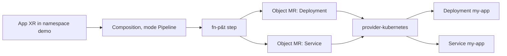

> **Draft — awaiting owner review.** Built from [Findings](./findings.md), the [PoC record](./poc/README.md) and the screened [Sources](./sources.md). One PoC ran (the default kind-only PoC, result **PARTIAL**). PoC-2 to PoC-5 from findings (Argo CD fit, function response cache, offline diff server, v1→v2 upgrade) were **not run**, so every claim about those comes from sources only. The hands-on steps are in [Guide: compose an app with a namespaced XR](./guide-namespaced-xr-app.md).

## Problem

Platform teams want to give application teams a small, self-service API ("give me an app", "give me a database") without each team learning every underlying Kubernetes or cloud resource. Crossplane calls itself "a framework for building cloud native control planes without needing to write code" ([Crossplane README](../../external-sources/crossplane-core-readme.md)). The question for this report: should Crossplane v2 be our control-plane layer, and what does using it actually look like today?

The PoC asked a narrower, testable version: can a kind-only cluster (no cloud credentials) run Crossplane v2.4.3 with provider-kubernetes and function-patch-and-transform, so that one namespaced `App` object produces a Deployment and a Service, and keeps them in line? ([PoC — Question](./poc/README.md#question))

## Concepts

- **Control plane** — a set of controllers that keep watching declared desired state and keep changing the real world to match it ("reconciling"). Kubernetes itself is one.
- **Composite resource (XR)** — "a set of Kubernetes resources as a single Kubernetes object"; the custom API your users create ([Composite Resources](../../external-sources/crossplane-composite-resources-docs.md)). In the PoC this is `kind: App`.
- **Composite Resource Definition (XRD)** — defines the XR's schema (its fields), like a CRD. In v2 (`apiextensions.crossplane.io/v2`) the `scope` field defaults to `Namespaced` ([What's New in v2](../../external-sources/crossplane-v2-whats-new-docs.md)).
- **Composition** — "a template for creating multiple Kubernetes resources as a single composite resource". In v2 it is a **pipeline** (`mode: Pipeline`) of steps; each step calls a **composition function** ([Compositions](../../external-sources/crossplane-compositions-docs.md)).
- **Composition function** — a small packaged program (it runs as its own pod) that Crossplane asks "which resources should exist for this XR?" ([Compositions](../../external-sources/crossplane-compositions-docs.md)). **function-patch-and-transform (fn-p&t)** is the function that carries the old v1 "patch and transform" style forward: a base resource plus patches copying fields from the XR ([fn-p&t README](../../external-sources/crossplane-function-patch-and-transform-readme.md)). v2 removed native patch-and-transform, so this function is now the path for that style ([What's New in v2](../../external-sources/crossplane-v2-whats-new-docs.md)).
- **Managed resource (MR)** — a Kubernetes object that "represents an external service in a Provider"; `spec.forProvider` is treated as the source of truth ([Managed Resources](../../external-sources/crossplane-managed-resources-docs.md)).
- **Provider** — a package that adds MR types and the controllers that talk to an external API ([Providers](../../external-sources/crossplane-providers-docs.md)). **ProviderConfig** tells a provider how to authenticate; a namespaced ProviderConfig applies only to MRs in its namespace ([Providers](../../external-sources/crossplane-providers-docs.md)).
- **provider-kubernetes / Object** — a provider whose MR, `Object`, wraps an arbitrary Kubernetes manifest and reconciles it onto a cluster ([provider-kubernetes README](../../external-sources/crossplane-provider-kubernetes-readme.md)).
- **Synced / Ready** — the two XR status conditions. Synced=True means Crossplane can reconcile the XR; Ready=True means the pipeline reports all composed resources ready ([Composite Resources](../../external-sources/crossplane-composite-resources-docs.md)).
- **Drift** — the live object differs from the declared state because someone or something changed it outside the control plane.
- **Server-side apply (SSA)** — a Kubernetes update mode where the API server tracks which "field manager" owns each field. provider-kubernetes uses it by default since v1.2.0 ([provider-kubernetes README](../../external-sources/crossplane-provider-kubernetes-readme.md)).
- **Operations (alpha)** — run a function pipeline once to completion (like a Job), on a schedule, or on resource change; must be enabled with `--enable-operations` ([Operation](../../external-sources/crossplane-operation-docs.md)). Not tested.



The diagram is the shape the PoC ran ([PoC — Files](./poc/README.md#files)).

## Options

Within Crossplane v2 the choices that matter for a first adoption:

1. **Which composition function.** The v2.4 docs list function-go-templating, function-patch-and-transform, function-kro, function-python, function-kcl and function-cue, and five authoring styles (templated YAML, plain YAML, YAML+CEL, Python, KCL) ([Get Started With Composition](../../external-sources/crossplane-get-started-composition.md)). The PoC used only fn-p&t v0.11.2.
2. **What the composition emits.** In v2 an XR can compose "a plain Kubernetes resource (Deployment, Service)" directly, as long as Crossplane is granted RBAC for that kind ([What's New in v2](../../external-sources/crossplane-v2-whats-new-docs.md), [Compositions](../../external-sources/crossplane-compositions-docs.md)). The alternative, used by the PoC, is to wrap each manifest in a provider-kubernetes `Object` MR ([PoC — Files](./poc/README.md#files)). The v2 docs say v2 "removes the need for awkward abstractions like claims and provider-kubernetes Objects" ([What's New in v2](../../external-sources/crossplane-v2-whats-new-docs.md)). Direct composition was **not tested**.
3. **Which provider for real infra.** Cloud providers such as provider-upjet-aws are generated from Terraform providers by Upjet ([Upjet README](../../external-sources/crossplane-upjet-readme.md)); provider-upjet-aws v2.9.0 adds an alpha offline Plan/diff server ([provider-upjet-aws v2.9.0 notes](../../external-sources/crossplane-provider-upjet-aws-v2-9-0-notes.md)). Not tested.

Outside Crossplane, [Findings — Alternatives](./findings.md#alternatives) compares Terraform/OpenTofu, the Pulumi Kubernetes Operator, ACK, Config Connector and kro. Those comparisons are researcher opinion built on sources, not PoC results.

## Trade-offs

### Measured in the PoC

Single run, one kind cluster on a Linux arm64 host, Crossplane 2.4.3, provider-kubernetes v1.4.1, fn-p&t v0.11.2 ([PoC — Environment](./poc/README.md#environment-and-pinned-versions)). Timings are rough wall-clock observations, not benchmarks.

| Criterion | Result |
|---|---|
| XR reaches `SYNCED=True READY=True` | PASS (XR age 44s at check) |
| Exactly one Deployment + one Service | PASS |
| Update XR (port 80→8080, replicas 2→3) propagates | PASS, ~10s |
| Delete XR garbage-collects MRs, Deployment, Service | PASS |
| No cloud credentials (`InjectedIdentity`) | PASS |
| Drift reverted within ~60s | **PARTIAL** — see below |

Drift detail ([PoC — Drift reconcile details](./poc/README.md#drift-reconcile-details)):

- **Default settings: no fast revert.** A port edit was still in place after 2 minutes. res-lab read the provider-kubernetes `--poll` default as 10 minutes from the v1.4.1 source code; that value is not in a preserved KB source, so treat it as `unverified` here.
- **With `spec.watch: true` on the Object MR** (alpha per the PoC record): deleting the Service → recreated in ~20s; changing a leaf field (Service selector label) → reverted in ~2s.
- **List-field drift does not converge.** Patching `spec.ports[0].port` 80→9090 with `kubectl patch` left the Object MR at `Synced=False (ReconcileError)` with `spec.ports[0].name Required value`. The Service then had two field managers (provider `Apply`, `kubectl-patch` `Update`), and the provider's SSA merge on `ports[]` could not produce a valid object. It stayed broken rather than self-healing.

What this means in practice: with provider-kubernetes Objects, don't count on "Crossplane reverts any manual edit quickly". Enable `watch: true` if you need fast drift correction, and treat out-of-band edits to list fields (ports, containers, env) as an incident that needs a human.

Other things the PoC hit ([PoC — Failures and workarounds](./poc/README.md#failures-and-workarounds)):

- The ProviderConfig CRD only exists after the provider package is `Healthy`, so ordering matters.
- `kubectl get providers` was ambiguous; use `providers.pkg.crossplane.io` and `functions.pkg.crossplane.io`.
- The provider ServiceAccount was bound to `cluster-admin` (PoC shortcut, see [`01-provider.yaml`](./poc/README.md#files)). A least-privilege role was not tested.

### From the sources (not tested)

- **Multi-tenancy:** namespaced XRs and MRs let standard namespace RBAC apply; v2-style XRs don't use claims ([What's New in v2](../../external-sources/crossplane-v2-whats-new-docs.md)).
- **Footprint:** v2's managed resource definitions and the activation policy (MRAP) let you activate only the provider resources you use; the default MRAP activates everything (`*`) ([What's New in v2](../../external-sources/crossplane-v2-whats-new-docs.md), [Upgrade to v2](../../external-sources/crossplane-upgrade-v2-guide.md)). No numbers in sources.
- **Immutable fields:** Crossplane never deletes a resource because of a `forProvider` change, unlike Terraform's replace behaviour ([Managed Resources](../../external-sources/crossplane-managed-resources-docs.md)).
- **Write-only fields:** provider-kubernetes cannot reconcile write-only fields such as `Secret.stringData`; use base64 `data` ([provider-kubernetes README](../../external-sources/crossplane-provider-kubernetes-readme.md)). This is a separate SSA limitation from the list-field one the PoC found.
- **Operations are alpha**, need a feature flag, and only function-python supported them at launch ([Operation](../../external-sources/crossplane-operation-docs.md)).
- **Upgrade from v1:** only from v1.20, one minor at a time; no automated tool yet to move v1 cluster-scoped XRs/MRs to namespaced ones ([Upgrade to v2](../../external-sources/crossplane-upgrade-v2-guide.md)).
- **Support window:** v1.20 reaches EOL when v2.5 ships in November 2026 ([Crossplane README](../../external-sources/crossplane-core-readme.md)).

## How to use

The short version of what ran. Full copy-paste steps, with every manifest, are in [Guide: compose an app with a namespaced XR](./guide-namespaced-xr-app.md).

1. Install Crossplane core with Helm (chart `crossplane-stable/crossplane` 2.4.3) into `crossplane-system`.
2. Install the provider (`Provider` + `DeploymentRuntimeConfig` + RBAC) and the function (`Function`), then wait for both to be `Healthy`.
3. Apply a namespaced `ProviderConfig` with `credentials.source: InjectedIdentity`, so the provider uses its own ServiceAccount on the same cluster.
4. Apply the XRD (your API's schema) and the Composition (the pipeline that turns an XR into resources).
5. Users create the XR (`App`) in their namespace and watch `SYNCED`/`READY`.
6. Change the XR to update; delete the XR to remove everything it composed.

## Examples

Only manifests from [poc/](./poc/README.md) that ran on Crossplane 2.4.3 / provider-kubernetes v1.4.1 / fn-p&t v0.11.2 / kind node v1.32.2. Comments stripped; nothing else changed.

### The API: namespaced XRD (`04-xrd.yaml`)

```yaml
apiVersion: apiextensions.crossplane.io/v2
kind: CompositeResourceDefinition
metadata:
  name: apps.example.crossplane.io
spec:
  scope: Namespaced
  group: example.crossplane.io
  names:
    kind: App
    plural: apps
  versions:
    - name: v1alpha1
      served: true
      referenceable: true
      schema:
        openAPIV3Schema:
          type: object
          properties:
            spec:
              type: object
              properties:
                replicas:
                  type: integer
                image:
                  type: string
                port:
                  type: integer
              required:
                - replicas
                - image
                - port
```

### What the user writes: the XR (`06-xr.yaml`)

```yaml
apiVersion: example.crossplane.io/v1alpha1
kind: App
metadata:
  name: my-app
  namespace: demo
spec:
  crossplane:
    compositionRef:
      name: apps.example.crossplane.io
  replicas: 2
  image: nginx:1.27-alpine
  port: 80
```

Note the v2 layout: Crossplane's own fields sit under `spec.crossplane` ([What's New in v2](../../external-sources/crossplane-v2-whats-new-docs.md)).

Result ([PoC — Output](./poc/README.md#output-trimmed)):

```text
NAME     SYNCED   READY   COMPOSITION                  COMPOSITIONREVISION          AGE
my-app   True     True    apps.example.crossplane.io   apps.example.crossplane.io-…  44s

NAME                  KIND         PROVIDERCONFIG        SYNCED   READY
my-app-eafa7c4f05bf   Deployment   kubernetes-provider   True     True
my-app-f2568632d991   Service      kubernetes-provider   True     True
```

### The pipeline: Composition (`05-composition.yaml`, Service step)

The Deployment step has the same shape (base `Object` + patches for `replicas` and `image`); see the [guide](./guide-namespaced-xr-app.md#5-define-the-api-and-the-composition) for the full file.

```yaml
apiVersion: apiextensions.crossplane.io/v1
kind: Composition
metadata:
  name: apps.example.crossplane.io
spec:
  compositeTypeRef:
    apiVersion: example.crossplane.io/v1alpha1
    kind: App
  mode: Pipeline
  pipeline:
    - step: app-bundle
      functionRef:
        name: function-patch-and-transform
      input:
        apiVersion: pt.fn.crossplane.io/v1beta1
        kind: Resources
        resources:
          - name: service
            base:
              apiVersion: kubernetes.m.crossplane.io/v1alpha1
              kind: Object
              spec:
                watch: true
                providerConfigRef:
                  kind: ProviderConfig
                  name: kubernetes-provider
                forProvider:
                  manifest:
                    apiVersion: v1
                    kind: Service
                    metadata:
                      name: my-app
                      namespace: demo
                      labels:
                        example.crossplane.io/app: my-app
                    spec:
                      selector:
                        example.crossplane.io/app: my-app
                      ports:
                        - port: 80
                          targetPort: 80
            patches:
              - type: FromCompositeFieldPath
                fromFieldPath: spec.port
                toFieldPath: spec.forProvider.manifest.spec.ports[0].port
```

(This excerpt omits the `deployment` entry that sits before `service` in the real `resources:` list.) `watch: true` is what made whole-object and leaf-field drift revert in seconds; without it the PoC saw no revert within 2 minutes.

### Update and delete

```bash
kubectl patch app my-app -n demo --type=merge -p '{"spec":{"port":8080,"replicas":3}}'
kubectl delete app my-app -n demo --wait=true
```

```text
replicas=3/3 svc-port=8080  (applied in ~10s)
app "my-app" deleted -> no Object MRs, no Deployment, no Service remain
```

## Conclusion / Recommendation

**Tentative** (one PoC, PARTIAL; four PoCs not run).

1. **Crossplane v2 is a reasonable choice for new self-service platform APIs.** The core loop works as documented: a namespaced XR, a function pipeline, create/update/delete with garbage collection, no cloud credentials needed to try it. This is now measured, not just read.
2. **Start with fn-p&t for simple compositions**, as findings suggest; it ran cleanly at v0.11.2. Evaluate other functions when you need loops or conditionals ([Get Started With Composition](../../external-sources/crossplane-get-started-composition.md)).
3. **Don't rely on provider-kubernetes `Object` for fast drift correction.** Defaults gave no quick revert, and list-field drift broke reconciliation even with `watch: true`. Before committing to the `Object` pattern for app bundles, test direct composition of Deployment/Service (v2's stated preferred path). That test may change this point.
4. **Don't grant `cluster-admin` outside a lab.** It was a PoC shortcut.
5. **Hold on production v1→v2 migration, Operations, the function response cache, and the offline diff server** until their PoCs run; today those rest on sources only.
6. **GitOps pairing with Argo CD** (Argo CD applies XRDs/Compositions/XRs, Crossplane reconciles them) is still researcher opinion; see [Findings — GitOps fit](./findings.md#gitops-fit-with-argo-cd) and the [Argo CD report](../argocd/report.md). PoC-2 would confirm it.

What would change this: PoC-2 (Argo CD health on XRs) could strengthen point 6; a direct-composition drift test could remove or soften point 3; PoC-5 (v1.20→v2.4 upgrade) decides point 5 for migration.

## Gaps

Open items, by owner (no one is pinged from here).

**res-lab**

- PoC-2 (Argo CD applies XRD/Composition/XR, reports health), PoC-3 (function response cache), PoC-4 (offline diff server), PoC-5 (v1.20→v2.4 upgrade): not run. PoC-4's `upbound/provider-aws` pin needs re-checking because the repo now redirects ([PoC — Environment](./poc/README.md#environment-and-pinned-versions)).
- Drift test with **direct composition** (Deployment/Service emitted as-is, no `Object` wrapper), to see if the slow-poll and list-field problems go away.
- Re-check the list-field SSA failure on a newer provider-kubernetes or another management-policy setup (PoC marks it unverified).
- A least-privilege role for the provider instead of `cluster-admin`.
- Version notes in the PoC record are inconsistent: the environment table says kind v0.27.0 while the pin-correction note says kind 0.20.0 → 0.33.0. Kubectl client v1.37.1 against a v1.32.2 node is also a wide gap; not shown to matter here.

**res-researcher**

- Ingest a source for the provider-kubernetes `--poll` default (10m) and for `spec.watch` maturity (alpha vs beta); both are currently from code reading and provider logs.
- Findings' version pins (provider-kubernetes 1.0.0, fn-p&t 0.8.2, function-go-templating 0.9.2) are stale per res-lab's re-check.
- Open questions in [Findings — Open questions](./findings.md#open-questions) (scale numbers, function pod overhead, Operations vs GitOps) still have no source.

**Owner (Scorpion-Aug)**

- Approve or reject running PoC-2 to PoC-5 (cluster installs), and confirm whether this draft should later be promoted to `articles/`.

## Sources and versions

Tested versions (from [PoC — Environment](./poc/README.md#environment-and-pinned-versions)): Crossplane Helm chart 2.4.3, provider-kubernetes v1.4.1, function-patch-and-transform v0.11.2, kind v0.27.0 with node `kindest/node:v1.32.2`, Helm v3.22.1, kubectl v1.37.1, host Linux arm64. Run date 2026-11-04.

Preserved sources cited here (all fetched 2026-11-04, docs v2.4 unless noted):

- [Crossplane README](../../external-sources/crossplane-core-readme.md) (main)
- [What's New in v2](../../external-sources/crossplane-v2-whats-new-docs.md)
- [Composite Resources](../../external-sources/crossplane-composite-resources-docs.md)
- [Compositions](../../external-sources/crossplane-compositions-docs.md)
- [function-patch-and-transform README](../../external-sources/crossplane-function-patch-and-transform-readme.md) (main; predates v2's removal of native P&T)
- [Get Started With Composition](../../external-sources/crossplane-get-started-composition.md)
- [Managed Resources](../../external-sources/crossplane-managed-resources-docs.md)
- [Providers](../../external-sources/crossplane-providers-docs.md)
- [provider-kubernetes README](../../external-sources/crossplane-provider-kubernetes-readme.md) (main)
- [Operation](../../external-sources/crossplane-operation-docs.md)
- [Upjet README](../../external-sources/crossplane-upjet-readme.md) (main)
- [provider-upjet-aws v2.9.0 notes](../../external-sources/crossplane-provider-upjet-aws-v2-9-0-notes.md)
- [Upgrade to Crossplane v2](../../external-sources/crossplane-upgrade-v2-guide.md)

## Related

- [Sources](./sources.md)
- [Findings](./findings.md)
- [PoC](./poc/README.md)
- [Guide: compose an app with a namespaced XR](./guide-namespaced-xr-app.md)
- [Argo CD report](../argocd/report.md) — GitOps layer that would apply these manifests
